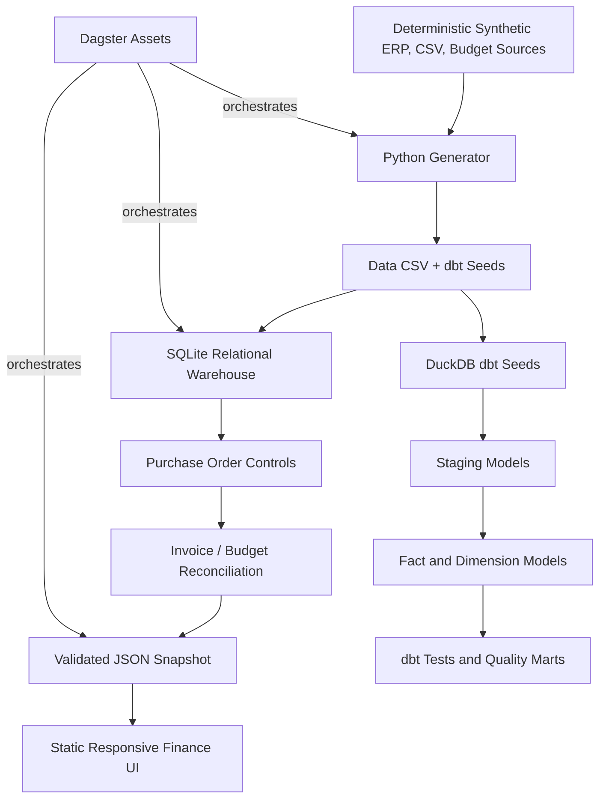

# Architecture and financial invariants

## Reference-model invariant

**Sum of EUR invoice amounts == Sum of actual EUR budget amounts** across brand × month × category. If not, `src/fpi/pipeline.py` raises before publishing the HTML snapshot.

Amounts are modeled in **integer cents** in SQLite to prevent non-deterministic binary floating-point addition, with explicit rounding only when converting to EUR using fixed illustrative exchange rates. Upstream invoice source amounts remain in their original currency.

## Synthetic data quality scenarios

- Missing PO for specific invoices: IDs 31, 133, 251, 409.
- Amount over 110% of PO for: IDs 74, 168, 309.
- One deliberately duplicated business invoice event using a different source invoice ID.
- A secondary PO-reference inconsistency arises when the deliberately duplicated business event shares a PO while another source PO record remains unused.
- Other invoice records are generated deterministically with random seeded values.

The current control policy uses **four named failures**: MISSING_PO, PO_MISMATCH, OVER_PO_LIMIT, DUPLICATE. An invoice receives exactly one primary outcome; in real systems multiple findings would be recorded in an audit/control table.

## dbt modeling grain

- `fct_invoices`: 1 invoice.
- `dim_suppliers`: 1 supplier.
- `dim_brands`: 1 fictional brand.
- `fct_budget_actuals`: brand × month × category.
- `fct_supplier_spend`: 1 supplier.
- `fct_data_quality`: 1 outcome category.

The verification command `python -m src.fpi.verify` reconciles every dbt invoice amount and control outcome, budget-grain amounts, mart totals and snapshot KPIs with the Python/SQLite reference output. dbt and all three Dagster assets are executed in CI before publication.
