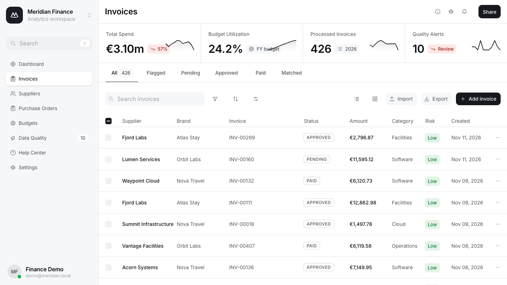
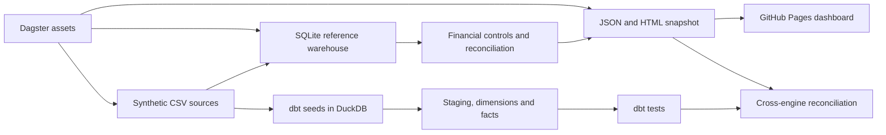

# Finance & Procurement Intelligence

A reproducible finance analytics system for synthetic invoices, purchase orders,
suppliers and budgets across three fictional brands.

[Demo](https://dutuvalentin16-dev.github.io/finance-procurement-intelligence/) ·
[CI/CD](https://github.com/dutuvalentin16-dev/finance-procurement-intelligence/actions)



## Architecture and stack



- Python 3.11, SQLite and integer-cent monetary calculations in the reference pipeline.
- dbt with DuckDB: 4 seeds, 5 staging views, 6 dimension/fact tables and 22 data tests.
- Dagster: three dependent assets generate sources, load SQLite and publish a reconciled snapshot.
- HTML, CSS and JavaScript dashboard with inline SVG icons and responsive navigation.
- GitHub Actions validates both engines and Dagster before publishing to GitHub Pages.

Dagster orchestrates the reference pipeline; dbt runs separately in the verification
workflow. Snowflake and external ERP/API integrations are not implemented.

## Data pipeline

`src/fpi/generate.py` creates deterministic synthetic CSVs with seed 26. The pipeline
copies them into dbt seeds, loads SQLite, calculates controls, reconciles totals and
renders `docs/index.html` with embedded data plus `docs/snapshot.json`.

The default dataset contains **426 invoices**, **EUR 3,096,412.13 total spend** and
**10 control alerts**. These are synthetic dataset results, not business outcomes.
Supplier names, brands, dates and amounts are fictional. FX rates are fixed
illustrative constants; no live exchange rates or financial services are used.

## Financial reconciliation

`python -m src.fpi.verify` requires a complete successful dbt build and verifies:

- Each dbt invoice amount and primary control outcome against the reference snapshot.
- Equal spend across invoice, budget, supplier and quality marts.
- Exact brand × month × category budget and actual values across both engines.
- Invoice count, alert count, total budget and spend KPIs.
- Exact agreement between the embedded HTML data and JSON snapshot.

Reference amounts use integer cents; dbt uses decimal monetary values and rounds
EUR conversion per invoice. The invoice-to-budget dbt reconciliation also runs as a
SQL data test. The [model architecture](ARCHITECTURE.md) describes model grains.

## Data quality

Checks cover key uniqueness, required fields, relationships, supported invoice
statuses, missing purchase orders, PO supplier/brand mismatch, invoice amounts over
110% of PO value and duplicate business events. Each invoice receives one primary
control outcome. Intentionally invalid synthetic scenarios remain visible as alerts;
they are not silently removed from spend.

## Local setup

Use Python **3.11** and run from the repository root:

```bash
python3.11 -m venv .venv
source .venv/bin/activate
# Windows: .venv\Scripts\Activate.ps1
pip install -r requirements-lock.txt
cp analytics/profiles.example.yml analytics/profiles.yml
python -m src.fpi.pipeline
dbt build --project-dir analytics --profiles-dir analytics
python -m orchestration.definitions
python -m src.fpi.verify
python -m http.server 8000 --directory docs
```

Open `http://localhost:8000`. For Dagster's local interface:

```bash
dagster dev -f orchestration/definitions.py
```

The SQLite/static pipeline alone uses the Python standard library. The full
verification requires the pinned dbt, DuckDB and Dagster dependencies.

## Testing and deployment

```bash
python -m unittest discover -s tests -v
dbt build --project-dir analytics --profiles-dir analytics
python -m orchestration.definitions
python -m src.fpi.verify
```

The 13 Python tests cover source determinism, financial reconciliation, warehouse
integrity and control scenarios. CI runs these tests, dbt, all three Dagster assets,
cross-engine reconciliation and a generated-output drift check. Deployment uses a
separate job that requires validation success. Pull requests validate without
publishing. GitHub Pages is configured to use GitHub Actions.

## Dashboard

The dashboard reads the pipeline-generated snapshot. Search, status/quality tabs,
brand filters, sorting, list/grid views and filtered CSV exports operate on that data.
Dashboard, suppliers, PO coverage, budgets and quality views use the same snapshot.
KPI cards cover the full reference dataset; table filters do not change them.
Sparklines show monthly spend, cumulative spend/full-year budget, monthly invoice
counts and monthly alert counts.

CSV imports and added demonstration invoices exist only in browser memory and do
not change warehouse data or official KPI cards. Desktop uses a sidebar, tablet an
icon rail and mobile a navigation drawer; invoice tables scroll horizontally where
needed. [Mobile screenshot](assets/finance-mobile.png).

## Technical limitations

- The public application is a static reporting snapshot, not a live database service.
- Full rebuilds only; no incremental ingestion, external connectors or scheduler.
- Invoices cover January–November; budgets cover the full year. Utilization uses the
  full-year budget denominator, not a period-aligned year-to-date budget.
- Fixed FX and simplified controls are demonstrations, not accounting certification.
- One primary finding per invoice; no persisted multi-finding audit trail.
- Local browser additions/imports are temporary and do not update the trusted pipeline.
- Google Fonts is optional; the interface falls back to system fonts if unavailable.
