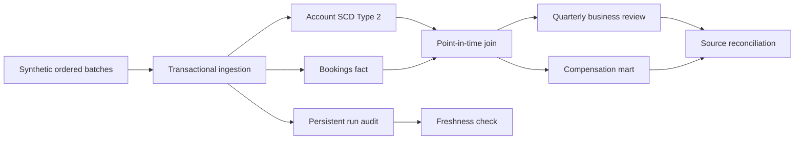

# Sales Analytics & Pipeline Reliability Lab

A compact, standalone analytics engineering case study: synthetic subscription bookings, historical customer attributes, quarterly sales reporting and a simplified compensation calculation. Designed to demonstrate correctness and failure recovery, not to imitate any employer's internal systems.

## Run the verified local reference

Python 3.10+; standard library only. From this directory:

```sh
python -m unittest discover -s tests -v
python pipeline.py
```

The demo creates `build/demo.sqlite` and `build/report.json`. Re-run to demonstrate idempotent batch handling; audit entries accumulate by design. Remove only the generated `build/` directory to reset the demo. No external credentials or network access are needed.

## Architecture



### Reproducible evidence

Local reference validated with 9 unit/integration tests. The seeded demo contains 5 bookings worth 850,000 fictional euro cents; 42,500 cents illustrative commission. An account changes region on April 1, and a late March sale retains its historical region. A replay is skipped; an invalid batch rolls back both dimension and fact changes and records a failed run. The April 4 freshness check flags the last successful April 2 batch as stale.

| Contract | Implementation |
|---|---|
| Fact grain | One immutable booking per sale ID; integer cents |
| Dimension grain | One account version per effective date; half-open validity interval |
| Replay | Same batch ID and payload: skip; modified payload: reject |
| Ordering | Strictly increasing batch dates; late facts allowed if their historical dimension exists |
| Quality gate | Raw count and amount agree with detail and both reporting marts |
| Incident | Atomic rollback, persisted failure reason and reproducible recovery |
| Freshness | Last accepted batch date compared to explicit reporting date |

Compensation is illustrative 5% per booking, rounded half-up; bookings are not recognized accounting revenue. All identifiers, dates and amounts are synthetic. No real customer, employee, employer, CRM or personal data. No secrets or external endpoints are used.

## Cloud adaptation (not deployed or runtime-tested)

`cloud/spark_reference.py` is a PySpark/Spark SQL batch-rebuild reference using the same fabricated inputs. It builds SCD2 intervals with window functions and checks historical attribution and totals. Syntax checked locally; Spark is unavailable in the local verification environment. It does not implement Delta incremental MERGE or ADF orchestration.

See [cloud design and runbook](cloud/design.md) for the proposed Azure Data Factory / Databricks implementation, control points and limitations. Do not claim production or cloud execution based on this local lab.
