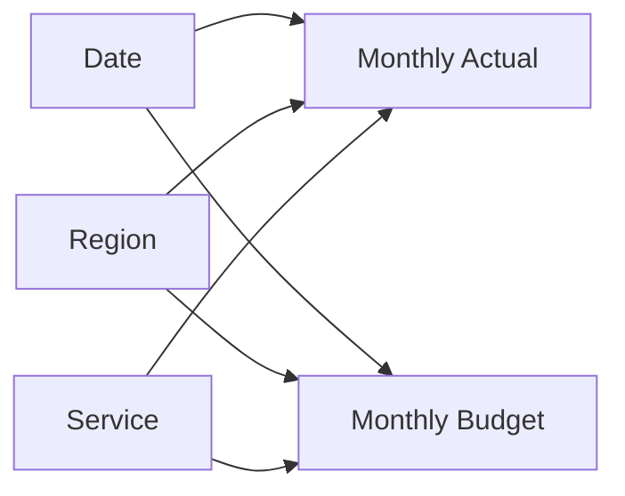

# Service Performance & Budget Reporting Lab

A reproducible BI case study for a fictional professional-services business: monthly actual vs budget, prior-year comparison and data quality. **Synthetic data only; no customer or employer data.**

## Quick start

Python 3.10+ (standard library only): `python reporting.py`. Generates six CSVs in `data/` and executes ten SQL-based quality checks. The data includes 24 months, three regions, three services, 216 rows in each fact, and a continuous 731-day calendar. The SQL reference reconciles counts and amounts and includes zero-budget and zero-actual exceptions. See the printed annual control totals.

## Model and business rules

Both facts have grain month-start × region × service; each stores integer euro cents. Actual means fictional billed services, not accounting-certified revenue. Variance is actual minus budget; positive means above budget. Variance % uses total variance divided by total budget, not an average of row percentages; zero budget returns blank. Use full-month/year filters, not partial-day selections. Prior-year growth is blank when no comparable period exists.

## Power BI Desktop build guide

1. Run the generator. Create a text parameter `DataFolder` pointing to `data/`. Create `LoadCsv` and the five queries in `import.pq` (one query per expression). Close & Apply.
2. Create six active one-to-many, single-direction relationships from each dimension key to the matching column in each fact. No fact-to-fact relationship. Mark dim_date as the date table using day. Disable auto date/time. Sort month by month number or use day at month granularity.
3. Add the nine measures in `measures.dax` individually. Format EUR and percentages. Hide technical keys and raw cents from report users.
4. Executive page: year/region/service slicers, Actual EUR, Budget EUR, Variance %, YoY %, monthly actual/budget line chart. Budget page: region × service matrix with variance conditional formatting and YTD measures. Validation page: full-year totals, zero-budget and zero-actual exceptions, reconciliation against the Python reference.
5. Compare unfiltered annual control totals and selected month/region/service totals to `reporting.csv`; confirm missing prior-year and zero-budget percentages are blank. Save a PBIX only after validating in Desktop. For service deployment, configure a supported source and refresh credentials outside Git, then verify access controls.

## Qlik alternative

`qlik.qvs` provides an optional load-script example and Set Analysis measure. It uses one comparison fact linked to three dimensions to avoid unintended composite associations. Configure the local data connection, reload and compare totals with the same reference.

## Verification and scope

The Python/SQLite reference is runnable offline. Power Query M, DAX and Qlik code are implementation templates; they have not been executed in Power BI Desktop or Qlik Cloud. This repository is not a PBIX, deployed BI workspace or screenshot of a completed native report. Never commit real data, personal details, credentials or local absolute paths.

## SQL control totals (local execution)

All ten checks passed. Amounts in fictional euro cents:

| Year | Actual | Budget |
|---|---:|---:|
| 2024 | 15,199,508 | 14,574,600 |
| 2025 | 15,177,840 | 14,622,073 |

Run the generator to recreate all inputs and verify these results.
